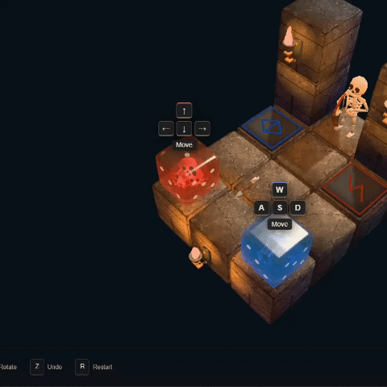

# Jelly & Bones

A physics-based co-op puzzle game about ancient technology, teamwork, and questionable career choices.

Four adventurers enter a dungeon looking for treasure. Someone presses the wrong button. Now they're jelly cubes with skeletons inside — and the dungeon's newly appointed maintenance crew.

Push crates, operate ancient machinery, dodge deadly traps, and try not to get your friends killed.

**You came for treasure. You got a shift.**

Play it on [itch.io](https://bobanko.itch.io/jellybones).

## Controls

- **WASD / Arrows / IJKL / TFGH** — move your jellies
- **Q / E** — rotate camera
- **1–4** — follow a character
- **Mouse wheel** — zoom
- **Z** — undo
- **R** — restart

Play solo or share a keyboard with friends. Teamwork is optional. Blaming each other isn't.

## How to play

- Guide all jellies to their matching runes and hold for 3 seconds to win
- Push crates (or friends) onto pressure plates to activate mechanisms
- Navigate lifts, conveyors, portals, and physics-based obstacles
- Pass through matching coloured energy blocks — including floors!
- Avoid spikes, skeleton archers, and deadly drones
- Use shields and swords to survive — or launch your friends across gaps
- Fell off? Respawn. Messed up? Press Z

## The story

Four adventurers enter an ancient dungeon in search of legendary treasure. Unfortunately, they anger a powerful wizard with a questionable sense of humour.

As punishment, he transforms them into colourful jelly cubes — skeletons included — and traps them in a series of increasingly ridiculous puzzles. To regain their original bodies, they must solve every challenge he throws at them.

Dying won't help. The wizard simply brings them back for another attempt. No escape. No death. Just puzzles.

## Tech

Vanilla JavaScript, WebGPU, custom soft-body physics. Includes a built-in 3D level editor — design your own workplace accidents.

Requires a browser with WebGPU (Chrome or Edge). Run `npm start` and open http://localhost:3000.

## More

- [Development and build](docs/development.md) — setup, sound generation, formatting, itch.io build, tests
- [Technical notes](docs/technical-notes.md) — level editor, mechanics, physics, graphics
